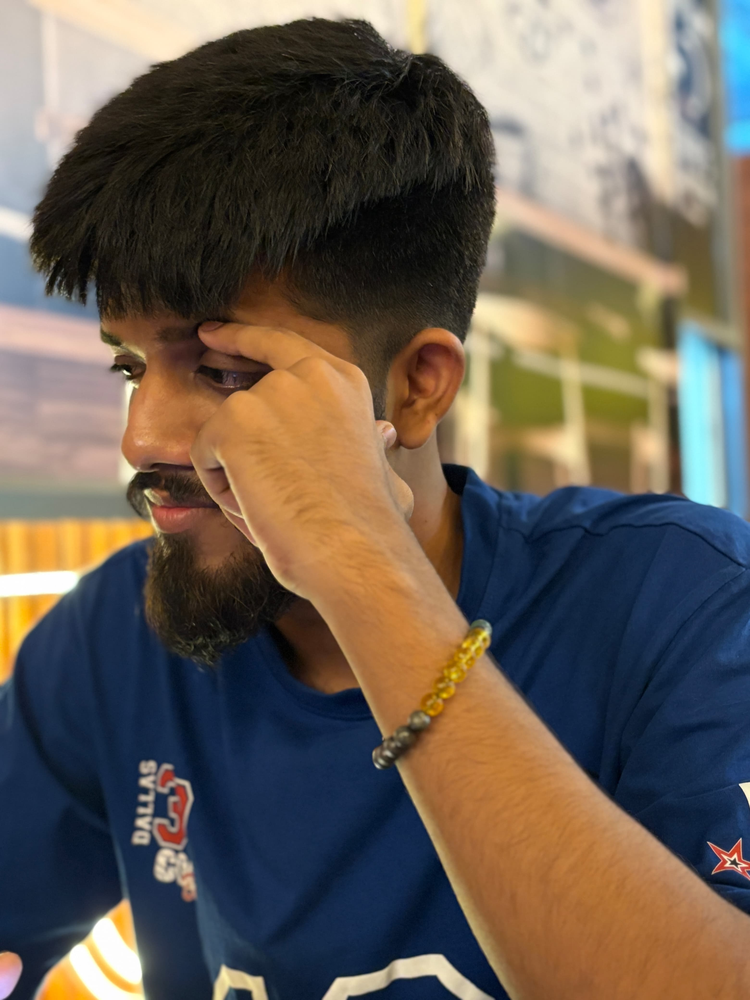

<!DOCTYPE html>
<html lang="en">
<head>
<meta charset="UTF-8">
<meta name="viewport" content="width=device-width, initial-scale=1.0">
<meta name="theme-color" content="#080808">

<title>For My Big Brother | 05.11.2026</title>

<link href="https://fonts.googleapis.com/css2?family=Cormorant+Garamond:wght@400;500;600;700&family=DM+Sans:wght@300;400;500;600&display=swap" rel="stylesheet">

</head>

<body>

<!-- INTRO -->

<section id="intro">

  

  

  

  

  

    
A Special Celebration

    <h1 class="intro-title">
      For My
      Big Brother
    </h1>

    

      A LITTLE SURPRISE FROM YOUR LITTLE BROTHER
    

    

      NOVEMBER 05 · 2026
    

    <button class="enter-btn" onclick="enterWebsite()">
      ENTER YOUR SURPRISE ✦
    </button>

  

</section>

<!-- COUNTDOWN -->

<section id="countdown-section">

  

    

      
The Moment Is Coming

      <h2>Counting Down To Your Day</h2>

      

      

        Every second brings us closer to celebrating someone truly special.
      

    

    

      

        <strong id="days">00</strong>
        Days
      

      

        <strong id="hours">00</strong>
        Hours
      

      

        <strong id="minutes">00</strong>
        Minutes
      

      

        <strong id="seconds">00</strong>
        Seconds
      

    

    

  

</section>

<!-- TWO SONGS -->

<section id="music-section">

  

    

      
A Song For Every Moment

      <h2>Music For Your Day</h2>

      

      

        A special melody while we wait for your birthday.
      

    

    

      
♫

      

        <h3 id="music-title">The Countdown Song</h3>
        
A special melody while we wait.

      

      <button class="music-button"
              id="music-button"
              onclick="toggleMusic()">
        PLAY
      </button>

    

    <!-- SONG BEFORE BIRTHDAY -->
    <audio id="song-before" loop preload="metadata">
      <source src="Song11.mp3" type="audio/mpeg">
    </audio>

    <!-- SONG ON BIRTHDAY -->
    <audio id="song-after" loop preload="metadata">
      <source src="Song22.mp3" type="audio/mpeg">
    </audio>

  

</section>

<!-- 12 GIFTS -->

<section id="gifts-section">

  

    

      
12 Little Surprises

      <h2>Open Your Gifts</h2>

      

      

        Each gift holds a little piece of love, gratitude, and memories.
         Tap every gift to discover what's inside.
      

    

    

    

      0 / 12 GIFTS OPENED

      

        

      

      

        Open every gift to unlock the final surprise.
      

    

  

</section>

<!-- PHOTO MEMORIES -->

<section id="memories-section">

  

    

      
Moments That Matter

      <h2>Our Little Memories</h2>

      

      

        Different moments, one beautiful bond.
      

    

    

      

        
        
Our Beginning

      

      

        
        
Good Times

      

      

        
        
Unforgettable

      

      

        
        
My Favourite

      

      

        
        
Always Together

      

      

        
        
Forever Us

      

    

  

</section>

<!-- LETTER -->

<section id="letter-section">

  

    

      
From My Heart

      <h2>A Letter To My Brother</h2>

      

    

    

      <h3>Dear Bhai,</h3>

      

        There are some people in life who make everything feel a little
        easier, a little safer, and a lot more meaningful.
        For me, you are one of those people.
      

      

        Having you as my big brother is one of the greatest blessings
        of my life. You have been more than just a brother.
        You have been a friend, a guide, a source of strength,
        and someone I can always look up to.
      

      

        I may not always say it, and sometimes I may not even show it,
        but I genuinely appreciate everything you do.
        Your presence means more to me than words can explain.
      

      

        On your birthday, I wish you endless happiness, good health,
        peace of mind, success in everything you do, and all the
        beautiful things this world has to offer.
      

      

        No matter how much we grow, where life takes us,
        or how busy our days become, one thing will never change:
        I will always be your little brother, and you will
        always be my big brother.
      

      

        Thank you for being you.
        Thank you for being my brother.
        And thank you for being a part of my life.
      

      

        With all my love, 
        Your Little Brother ❤️
      

    

  

</section>

<!-- CAKE -->

<section id="cake-section">

  

    

      
Make A Wish

      <h2>A Cake Just For You</h2>

      

      

        One candle. One wish. A thousand beautiful possibilities.
      

    

    

      

        

        

        

  
