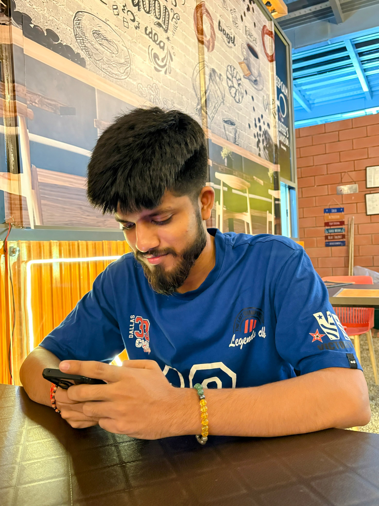
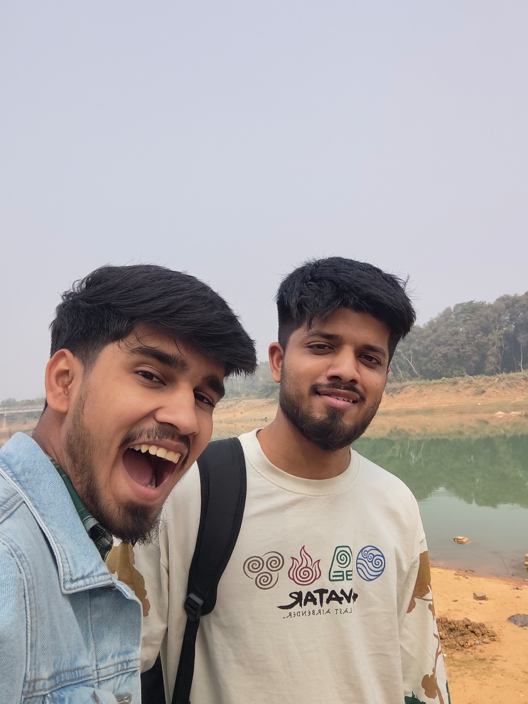
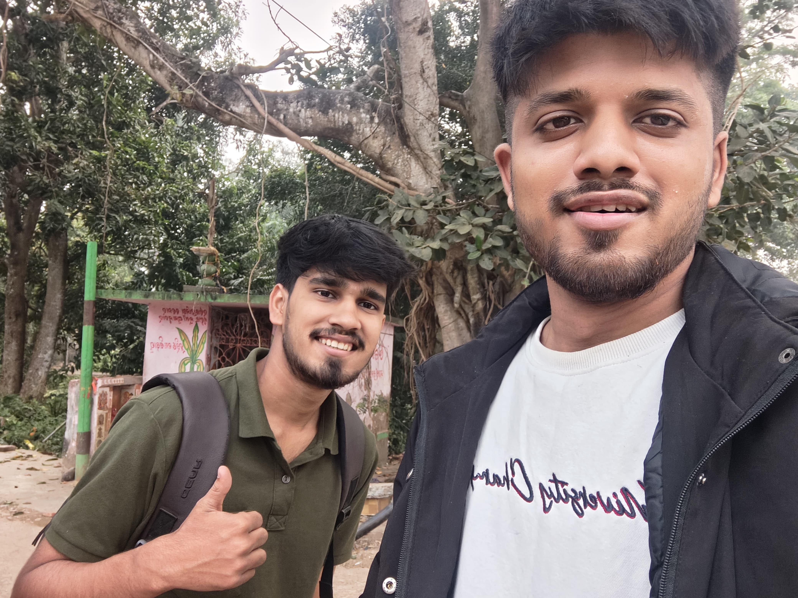

<!DOCTYPE html>
<html lang="en">
<head>
  <meta charset="UTF-8" />
  <meta name="viewport" content="width=device-width, initial-scale=1.0" />
  <title>Happy Birthday Bimal Bhai ❤️</title>

  <link rel="preconnect" href="https://fonts.googleapis.com">
  <link rel="preconnect" href="https://fonts.gstatic.com" crossorigin>
  <link href="https://fonts.googleapis.com/css2?family=Cormorant+Garamond:wght@400;500;600;700&family=Great+Vibes&family=Montserrat:wght@300;400;500;600;700&display=swap" rel="stylesheet">

  
</head>

<body>

  

  <!-- Music: the only song on the website -->
  

    
♫

    

      <strong>OUR SPECIAL SONG</strong>
      Song22.mp3
    

    <button class="music-toggle" id="musicToggle" aria-label="Play or pause music">▶</button>
  

  <audio id="birthdaySong" src="Song22.mp3" loop preload="auto"></audio>

  <main>

    <!-- HERO -->
    <section class="hero" id="home">
      

        
A little world made just for you

        <h1>Happy Birthday</h1>

        <h2>Dear Bimal Bhai</h2>

        

        

          For the person who has been more than a brother —
          a guide, a protector, a friend, and one of the most
          precious parts of my life.
        

        
05 · 11 · 2026

        <a href="#countdown" class="gold-button">Begin the surprise ✦</a>
      

      
Scroll to explore ↓

    </section>

    <!-- COUNTDOWN -->
    <section class="countdown-section center" id="countdown">
      
The special day is approaching

      <h2 class="section-title">The Countdown</h2>
      

        Every second brings us closer to celebrating someone truly special.
      

      

        

          <strong id="days">00</strong>
          Days
        

        

          <strong id="hours">00</strong>
          Hours
        

        

          <strong id="minutes">00</strong>
          Minutes
        

        

          <strong id="seconds">00</strong>
          Seconds
        

      

      
A beautiful day is on its way ✨

    </section>

    <!-- GALLERY -->
    <section class="gallery-section center" id="gallery">
      
Moments worth keeping

      <h2 class="section-title">A Gallery of Memories</h2>
      

        Some moments become memories. Some people make those memories unforgettable.
      

      

        

          
          
A moment to remember

        

        

          
          
Always together

        

        

          
          
The good old days

        

        

          
          
Little moments

        

        

          
          
Forever special

        

      

    </section>

    <!-- LETTER -->
    <section class="letter-section center" id="letter">
      
From my heart to yours

      <h2 class="section-title">A Letter for You</h2>
      

        Some feelings are too meaningful to fit into an ordinary birthday wish.
      

      

        
Dear Bimal Bhai,

        

          On your special day, I just want to remind you how much you mean to me.
          Having you as my big brother is one of the greatest blessings of my life.
        

        

          Thank you for being someone I can look up to, someone whose presence
          brings strength, and someone whose place in my life can never be replaced.
        

        

          I may not always say it, but I appreciate every little thing you do.
          Your support, your care, your guidance, and even the little moments
          we share mean more than words can explain.
        

        

          May this new year of your life bring you peace, happiness, good health,
          success, and everything your heart has been wishing for.
          May every dream you carry become a beautiful reality.
        

        

          No matter how much life changes, one thing will always remain the same:
          I will always be proud to call you my brother.
        

        

          Happy Birthday, Bhai. Keep smiling, keep shining, and keep being
          the wonderful person you are.
        

        
With love, always ❤️

      

    </section>

    <!-- TIMELINE -->
    <section class="timeline-section center" id="memories">
      
A journey of memories

      <h2 class="section-title">Our Little Timeline</h2>
      

        Not just years passing by — a collection of moments that made life special.
      

      

        

          <h3>The Beginning</h3>
          

            The beginning of a bond that would become one of the most meaningful
            parts of our lives.
          

        

        

          <h3>Growing Together</h3>
          

            Learning, laughing, making memories, and discovering that family
            is one of life's greatest gifts.
          

        

        

          <h3>Through Every Season</h3>
          

            The good days, the difficult days, and all the little moments in between —
            we keep moving forward.
          

        

        

          <h3>Today & Always</h3>
          

            Celebrating you today and wishing you countless more years of love,
            laughter, and unforgettable memories.
          

        

      

    </section>

    <!-- GIFTS -->
    <section class="gifts-section center" id="gifts">
      
A collection of little surprises

      <h2 class="section-title">12 Gifts, 12 Wishes</h2>
      

        Every gift holds a little message. Open all twelve to unlock the final surprise.
      

      

        

          Gifts discovered
          0 / 12
        

        

          

        

      

      

    </section>

    <!-- CAKE -->
    <section class="cake-section center" id="cakeSection">
      
Make a birthday wish

      <h2 class="section-title">A Cake Just For You</h2>
      

        Close your eyes, make a wish, and tap the cake to blow out the candle.
      

      

        

        

        

        

      

      
Make a wish, Bhai ✨

      <button class="gold-button" id="wishButton">Make a Wish</button>
    </section>

    <!-- FINAL SURPRISE -->
    <section class="final-section center" id="final">
      
One last surprise

      <h2 class="section-title">Something Special</h2>
      

        The final surprise is waiting. It opens when all twelve gifts have been discovered.
      

      

        
🔒

        <h3 id="finalTitle">A Surprise Is Waiting</h3>
        

          Open all 12 gifts above to unlock this final birthday message.
        

        <button class="gold-button" id="unlockButton" disabled>
          Unlock the Surprise
        </button>

        

          <h2>Happy Birthday, Bhai!</h2>
          

            You are not just my big brother — you are a part of my heart,
            my strength, and one of the greatest blessings in my life.
              
            May your life always be filled with happiness, peace, success,
            love, and beautiful memories.
              
            Whatever happens, wherever life takes us,
            I will always be grateful to have you as my brother.
              
            This little website is just a small reminder of a very big feeling:
              
            <strong class="gold">You are loved more than you know. ❤️</strong>
          

        

      

    </section>

  </main>

  <footer>
    Made with ♥ for Bimal Bhai · 05 November 2026
  </footer>

  <!-- GIFT MODAL -->
  

    

      <button class="modal-close" id="modalClose" aria-label="Close gift">×</button>
      
🎁

      <h2 id="modalTitle">A Special Gift</h2>
      

    

  

  

</body>
</html>
